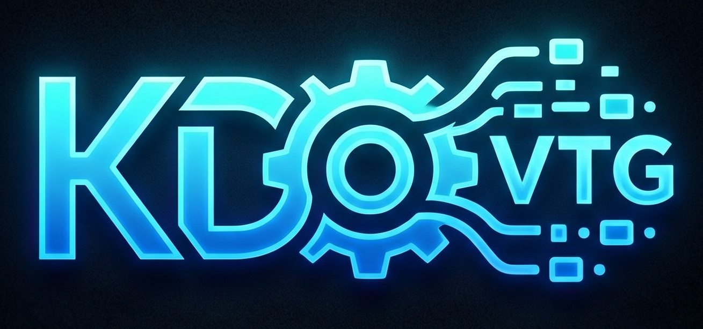
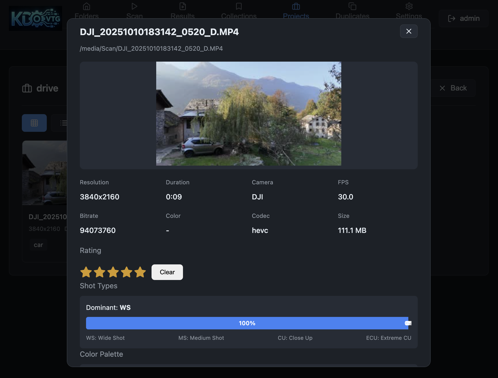

# KDO Video Tagger



**Organize, tag, and manage your video projects with AI-powered metadata extraction.**

KDO Video Tagger is a self-hosted web application that automatically extracts technical metadata from your videos and adds intelligent tagging powered by AI object detection.

[](https://opensource.org/licenses/MIT)
[](https://www.python.org/downloads/)
[](https://www.docker.com/)
[](https://github.com/omrik/kdo-vtg/releases)
[](https://buymeacoffee.com/omrik)

---

## Why KDO Video Tagger?

### Save Hours of Manual Work
Stop manually typing metadata for every clip. Scan folders with thousands of videos in minutes and get comprehensive information automatically.

### AI-Powered Object Detection
Enable YOLO-based object detection to automatically identify what's in your footage - people, vehicles, animals, equipment, and more.

### Perfect for Video Editors
Export straight into your NLE: **FCPXML** (Final Cut Pro, DaVinci Resolve), **Premiere Pro XML**, and a **DaVinci Resolve metadata CSV**. Tags arrive as keywords, scene cuts and AI chapters as markers, and your best-rated clips as favorites, with a ready-made selects timeline. Set your NAS share path once and clips link without relinking. See [Editor workflows](docs/EDITOR-WORKFLOWS.md).

### Works Where You Work
- **NAS** - Native packages for UGREEN App Center and Synology Package Center, plus templates for Unraid and CasaOS (amd64 + arm64). See [NAS guide](docs/NAS.md)
- **Local** - Works on Mac, Windows, or Linux
- **Private** - Self-hosted, your videos never leave your network

---



---

## Key Features

| Feature | Description |
|----------|-------------|
| **Automatic Metadata** | Resolution, duration, FPS, codec, bitrate, camera model |
| **AI Object Detection** | Identify people, objects, and scenes in your footage |
| **Scene Detection** | Automatically find shot boundaries and scene changes |
| **Transcription** | Local speech-to-text via faster-whisper (runs on-NAS, free) |
| **YouTube Chapters** | AI-generated chapter plans from visual index + transcript (optional) |
| **Color Analysis** | Extract dominant color palettes from videos |
| **GPS Location** | Read GPS coordinates from drone and action camera footage |
| **Star Ratings** | Rate your best clips |
| **Collections & Projects** | Organize videos your way |
| **Duplicate Detection** | Find similar or duplicate videos |
| **NLE Export** | FCPXML (Final Cut / Resolve), Premiere Pro XML, Resolve metadata CSV, EDL, with keywords, markers and a selects timeline |
| **Spreadsheets** | CSV, Excel, PDF shot lists |

---

## Quick Start

**Easiest (Linux/macOS):**

```bash
curl -fsSL -o install.sh https://raw.githubusercontent.com/omrik/kdo-vtg/main/install.sh
MEDIA_PATH=/path/to/your/videos bash install.sh
```

**Manual (any Docker host):**

```bash
docker pull ghcr.io/omrik/kdo-vtg:latest
docker run -d -p 8080:8000 \
  -v /path/to/your/videos:/media:ro \
  -v kdo-vtg-config:/app/config \
  ghcr.io/omrik/kdo-vtg:latest
```

Access at `http://localhost:8080`

---

## YouTube Chapters (optional, AI-powered)

Generate YouTube chapter plans per video (and consistently across a series) from the
visual index kdo-vtg already computes (scene cuts, YOLO tags, shot types) plus a local
Whisper transcript. Chapter planning is sent to Google **Gemini** — you need your own
API key for this one feature only.

- **Everything else works without a key.** Chapter generation simply returns a clean
  `503` error until you set one.
- Transcription runs locally on your NAS via [`faster-whisper`](https://github.com/SYSTRAN/faster-whisper) —
  free, no API needed.
- **Never commit your key.** Set it in the environment of the NAS deployment:

```bash
# in your .env or shell before running docker compose
export GEMINI_API_KEY=your_key_here
```

```yaml
# docker-compose.yml (passthrough is already configured)
environment:
  - GEMINI_API_KEY=${GEMINI_API_KEY:-}
```

> Series consistency: when a video belongs to a **Project**, sibling episodes are passed
> to Gemini as `SERIES_CONTEXT` so every episode's chapter titles match in style.

---

## Supported Cameras

- DJI Drones (Mavic, Mini, Phantom, Inspire)
- GoPro
- iPhone
- Insta360
- Sony, Canon, Nikon
- Any camera with MP4/MOV files

---

## Documentation

- [Installation Guide](docs/INSTALLATION.md) - Detailed setup for NAS and local
- [NAS Guide](docs/NAS.md) - UGREEN, Synology, Unraid, CasaOS, QNAP, TrueNAS, PUID/PGID
- [Editor Workflows](docs/EDITOR-WORKFLOWS.md) - Importing into Final Cut, Resolve and Premiere
- [User Guide](docs/USAGE.md) - How to use all features
- [Development](docs/DEVELOPMENT.md) - For contributors

---

## Support This Project

KDO Video Tagger is free and open source (MIT). If it saves you hours of sorting
through footage, a coffee is hugely appreciated — and keeps me building:

[](https://buymeacoffee.com/omrik)

---

## FAQ

### Does KDO Video Tagger upload my footage anywhere?
**No.** Scanning, tagging, scene detection, object detection, color analysis, and
transcription all run locally on your machine or NAS. The only feature that contacts
an external service is optional **YouTube Chapters**, and only when you provide your
own Google Gemini API key.

### I get 503 when I click "Generate Chapters" — is it broken?
No. Chapter generation needs a Gemini API key (Settings → AI & Transcription). Your
key is stored on the server, never committed, and masked in the UI.

### How do I update?
Pull the latest image and restart:

```bash
docker pull ghcr.io/omrik/kdo-vtg:latest
docker compose up -d
```

Your config and database live in the `config` volume and are preserved.

### Which NAS devices are supported?
Anything that runs Docker, on Intel/AMD (amd64) or ARM (arm64): UGREEN (App Center
package), Synology DSM 7.2+ (Package Center package or Container Manager), Unraid,
CasaOS/ZimaOS, QNAP, TrueNAS, TerraMaster, or any Linux host. See the [NAS guide](docs/NAS.md).

### I get "config is not writable" on my NAS
Set `PUID`/`PGID` to a NAS user that can read your media share and start the
container with `user: "0:0"`. The app chowns only its config folder, then drops
root. Details in [docs/NAS.md](docs/NAS.md#file-permissions-puid--pgid).

### Is it really free?
Yes — MIT licensed, no accounts, no per-seat fees. Optional add-ons (like Gemini
chapters) use your own API keys.

---

## Tech Stack

Python • FastAPI • React • TypeScript • FFmpeg • YOLOv8 • Docker

---

## License

[MIT](LICENSE)
